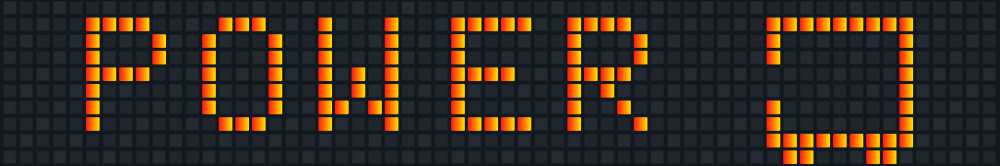

<h1 align="left">Hi there, I'm Yasuru 👋</h1>

I'm an <strong>Information Systems undergraduate at UCSC 🎓</strong> with a keen interest in Web Development and Data Science 💻📊. I enjoy building for the web, exploring data, and bringing ideas to life through code. Always curious and learning something new — usually with a cup of tea nearby 🍵✨.

<h2 align="left">🛠️ Technologies &amp; Tools</h2>

 

<table>
<tr>
<td align="center"> HTML5</td>
<td align="center"> CSS3</td>
<td align="center"> JavaScript</td>
<td align="center"> TypeScript</td>
<td align="center"> C</td>
<td align="center"> C++</td>
<td align="center"> Python</td>
<td align="center"> Kotlin</td>
<td align="center"> Flutter</td>
<td align="center"> React</td>
<td align="center"> React Native</td>
<td align="center"> MySQL</td>
<td align="center"> pandas</td>
<td align="center"> NumPy</td>
<td align="center"> Git</td>
<td align="center"> VS Code</td>
</tr>
</table>

<h2 align="left">🌟 Let’s Connect</h2>

Let’s share ideas and build something together.

&nbsp;&nbsp;
&nbsp;&nbsp;
&nbsp;&nbsp;

 

<em>A little code. A little tea. A lot of curiosity.</em>

